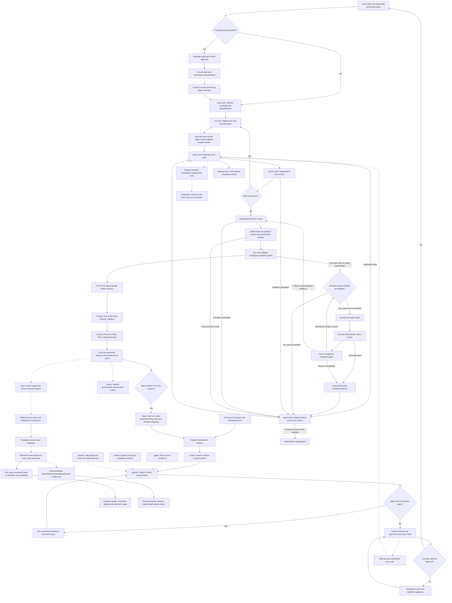

# Devflow workflow

## Work orchestration

The coordinating agent selects skills, runs helpers and arranges separate review
invocations. The journal records progress and enforces gates. An explicit, opted-in
bounded repair command can launch one scoped native worker for a failed configured
hardening gate. Solid arrows below show the agent's process.



After changes, renew affected evidence and review packages before advancing.
Repair is manual by default. `repair configure` enables a bounded policy;
`repair next` requires a known cost estimate and an active implementer binding.
Claims are journaled before native launch. A claimed/interrupted cycle blocks
replay and handoff until reconciled. The runner reruns only failed configured
hardening gates; findings or failed item proofs outside those gates still need
agent-led verification. Worker prose never counts as proof.
A terminal worker failure or gate-runner error journals an aborted cycle and
typed remaining failures, stopping further automatic repair for that run.
An active native invocation still requires stopped-worker reconciliation.
Selected runs can opt into a redacted improvement trace. Reviewer feedback
binds its exact trace hash; a distinct approving actor promotes a candidate
to the durable case set. `improve run-cases` executes only approved cases,
and `improve compare` requires identical case hashes/scoring versions. Missing
usage remains unknown; comparison never promotes a skill or policy automatically.
`improve model-evaluate` reads approved stage cases and supplied observed
results. A representative report is review material; it does not install a
provider mapping. The released policy reader requires matching report, host
version and model revision evidence before a default can be strict eligible.
With explicit user authorization, `host goal-status` supplies a completion
contract and `host goal-bind` records an opaque host-specific Goal reference.
The agent activates the host Goal through its supported session command; no
portable automatic lifecycle API is claimed. Goal state cannot override journal
gates. Handoff carries the contract but never a source Goal ID.
Unconfigured tests are not enforced. Gap discovery/interviews are agent-led;
`spec gaps` lists recorded unanswered questions and approval does not currently
reject them automatically. Migration delivery also requires recorded predecessor
and parity evidence. Resume any stage from journaled run status and gate status.
Hardening gates default to command exit status. When a scanner is configured
with `json-report` version 1, require a valid `{"findings":[]}` report: missing
or malformed output and nonempty findings block advancement even if the command
exits zero. Keep the configured report contract bound to its journaled proof.
See [specify](../specify/SKILL.md), [build-work](../build-work/SKILL.md) and
[review-work](../review-work/SKILL.md) for the focused flows.

Use the bundled helper to inspect or advance a workflow. Supply an explicit control root for stateful commands; loading this skill does not create files. Devflow supports context, repository registration, approved requirements, validated plans, resumable attempts, attempt-bound code/IaC/agent-evaluation proof, independent review records, requirement acceptance, and exact-head delivery manifests. Infrastructure apply, hardening tools, external PR creation, merge execution, and cleanup remain conditional on configured tools and explicit user authorization.

```sh
python3 <skill-directory>/scripts/run.py version
```

Store state only under the chosen root:

```sh
python3 <skill-directory>/scripts/run.py context set --root <control-root> --layer org --file org.json
python3 <skill-directory>/scripts/run.py context resolve --root <control-root>
python3 <skill-directory>/scripts/run.py repo register --root <control-root> --repo-id <stable-id> --location <checkout>
python3 <skill-directory>/scripts/run.py spec store --root <control-root> --file spec.json
python3 <skill-directory>/scripts/run.py spec validate --file spec.json
python3 <skill-directory>/scripts/run.py spec approve --root <control-root> --confirm-hash <current-content-hash> --actor-id <approving-human-id>
python3 <skill-directory>/scripts/run.py plan validate --root <control-root> --file plan.json
python3 <skill-directory>/scripts/run.py run start --root <control-root> --run-id <run-id>
python3 <skill-directory>/scripts/run.py run next --root <control-root> --run-id <run-id>
python3 <skill-directory>/scripts/run.py run gate-status --root <control-root> --run-id <run-id>
```

Resume by run ID with `run status`; the active attempt token remains bound to the saved state version. `run brief` reassembles the scoped context without issuing a token; `run inspect` retrieves the full run record on request. Submit a result with `run result`, abandon with `run abandon`, or retry a prior attempt with `run retry`. Read the exact acceptance criteria and unavailable gates returned by `run next`. A result without kind-matched verifier proof does not complete a work item. Follow the current stage from `run gate-status`: implementation, item review, branch review, acceptance, hardening, or delivery. Brief byte limits never truncate mandatory criteria; overflow reports the required size and references.

Deterministic operations record best-effort byte and duration measurements under the chosen root. Read `offload.jsonl` to inspect the measures; these bytes do not establish actual tokens saved. Reuse context projections only when source and resolver fingerprints match.

Use the focused Devflow skills for project context, specification, planning, build verification, and independent review. Prepare and verify delivery manifests, then stop at the human's local-merge / pull-request / retained-branch decision. The helper never performs those external effects automatically. Treat event journal state and evidence as authoritative. The dispatcher requires Python 3.11+ and `fcntl` on macOS/Linux; no daemon or dependencies are required.

## Documentation

Start with [project setup and initialization](../../docs/setup-and-usage.md).
See [usage guide and examples](GUIDE.md) for prerequisites, commands, input shapes,
outputs and recovery. The [documentation index](../../docs/skills.md) covers shared
setup and all DevFlow skills.

## Explicit project initialization

When the user invokes workflow, resolve `scripts/run.py` relative to this loaded
skill directory. Detect an existing Python 3.11+ interpreter and invoke bundled
helpers yourself; no user environment variables or direct Python setup are needed.
Capture `version` while loading these instructions and retain its release descriptor.
Call `host init --project-dir <actual host working directory> --operation-id <unique ID>`.
Use the returned control root and stable repo ID. Select a run only when one is
unambiguous; ask a concise selection question for multiple runs. Initialization
never approves specs or creates a run without its ordinary prerequisites.

## Shared host contract

When explicitly attached, retain the current binding ID/revision and include them
in workflow mutations; transferred/stale bindings require refresh. Map actual
host task IDs explicitly and check completion using the shared host policy.
For model work here request `implementation` stage routing; deterministic helper execution
uses no separate model. Unknown effective settings remain advisory; strict mode
blocks. New scoped workers use bundled native discovery and launch; explicit advisory
pins require user permission for unvalidated suitability. Claude effort remains unobservable. See [host contracts](../../docs/hosts.md) for handoff and model limits.

Before new model work, resolve the relevant stage with `host profile-resolve` for
this binding. Use `host model-discover` for the native account context, then
`host model-run` with a unique invocation and operation ID for an eligible scoped
worker. The bundled helper applies supported native controls and records actual
host observations. Parent conversation settings stay under user control. If only an advisory
recommendation is available, disclose it and preserve user/account choices.
An unavailable pin or strict blocker requires a user decision, not silent fallback.
Record immutable invocation receipts and interruptions; do not supply caller claims
as observed host settings. Preferences may name a specific stage and apply only to
new invocations. After rework/refresh, explicitly remap the task using the previous
mapping hash returned by `host status`.

Receipts must be created for the actual active invocation and mapped to its exact
binding/role/stage/item token or review package. Preferences update fields; use
explicit `clear` for removal. Known mapped tasks with inconsistent locators block.
After a compatible upgrade, refresh an active binding or explicitly resume the
exact detached revision without changing identity, then remap tasks. See the
[recovery contracts](../../docs/hosts.md#review-fixes-and-remaining-model-scope).
To attach this session to a new active run after its prior run is delivered or
discarded, use a new binding ID and the new run ID. Attachment atomically detaches
the terminal binding and clears its task mappings; a running worker or repair
cycle blocks the switch. Do not refresh the old binding with a different run ID.

Before delegated model work, follow the [native invocation guide](../../docs/native-models.md).
Keep the actual actor/stage and item token or review package. Hooks never launch
workers. Preserve blocked policy decisions and classify interrupted work before
any replacement. Deterministic operations do not need a model invocation.

Before planning, starting runs, transferring hosts or delivering repository-backed
work, use the shared live specification preflight. Observed pair drift requires
explicit human reapproval even after restoration. Keep legacy journal flows
readable; migration creates an unapproved visible candidate and preserves targets.
See the [guide](GUIDE.md#repository-specification-preflight) for recovery.


## Governing-document evidence

Before new plan, build, review, delivery or host handoff work, the runner checks
repository specification approval and applicable governing inputs together.
Relevant organization and project rules are always included unless the project
manifest records an explicit `irrelevance_decisions` entry with `rule_id` and a
nonempty `reason`. The receipt stores applicable rule IDs, owning repositories,
paths, Git revisions, content digests and the effective digest. Documents remain
in their repositories; the receipt does not copy whole documents into briefs.

New or changed applicable governing files require separate human approval of
an exact proposal. Specification approval and Git commits cannot grant that
approval. Present the proposal's before/after hashes and exact diff for human
conflict review, including edits originally authored by the user; never fabricate
an approval event. Register the organization checkout before resolving inherited
rules. Unchanged historical files and unrelated edits do not need approval.
A handoff checks the prepared effective digest before changing ownership.


The accepted input receipt preserves file bytes for exact before-image recovery.
Proposals compare edits against this accepted baseline even after a Git commit.
An approval authorizes that exact before/after change; a historical approval for
the same after image cannot authorize restoration from a different baseline.
Committing an already accepted edit preserves its approval. A legacy receipt
without recoverable baseline bytes fails closed if its Git baseline differs.

### Guided document setup
After host initialization, inspect the `document_setup` result. Offer project-only
(the default), attach an existing organization Git URL, or create a local organization
at an explicit user-chosen absolute directory outside the project. Use `setup inspect`
for read-only discovery and `setup initialize` with the selected choice. The agent
runs these helpers; plugin users need no folders, shell variables, or Python commands.
Adopt existing documents by explicit category, path and rule IDs. Never infer that
setup approves policy. An unavailable organization source blocks recovery/handoff.

Organization checkout HEAD must match the source's advertised HEAD. On
`GOVERNING_SOURCE_STALE`, block policy resolution and select a current clone or
request explicit recovery authorization; do not reset or switch a user checkout.
See the companion guide for stale runtime clone recovery.

## Governing input reassessment

Plan validation records the effective governing digest. An applicable policy
change after validation leaves a persistent `GOVERNING_REASSESSMENT_REQUIRED`
blocker, even after exact-diff approval or a repeated preflight. Reassess the
plan and verification impact, then explicitly validate the plan with a recorded
assessment. The helper checks that the assessment is nonempty; the agent and
human remain responsible for its substance and any required plan edits.

Runs retain their original governing digest. A run with an older digest remains
blocked with `RUN_GOVERNING_INPUTS_STALE` after plan revalidation. Preserve that
run and its evidence for audit and start a fresh run from the revalidated plan;
previous verification and review evidence are not carried forward. Discarding an
old run is a separate, explicit user-directed action, never automatic recovery.
