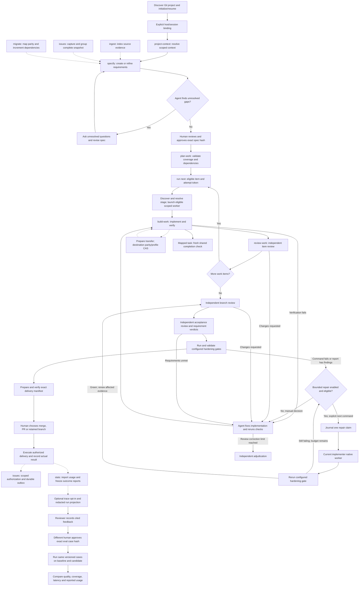

# Devflow workflow

## Work orchestration

The coordinating agent selects skills, runs helpers and arranges separate review
invocations. The journal records progress and enforces gates. An explicit, opted-in
bounded repair command can launch one scoped native worker for a failed configured
hardening gate. Solid arrows below show the agent's process.



After changes, renew affected evidence and review packages before advancing.
Repair is manual by default. `repair configure` enables a bounded policy;
`repair next` requires a known cost estimate and an active implementer binding.
Claims are journaled before native launch. A claimed/interrupted cycle blocks
replay and handoff until reconciled. The runner reruns only failed configured
hardening gates; findings or failed item proofs outside those gates still need
agent-led verification. Worker prose never counts as proof.
Selected runs can opt into a redacted improvement trace. Reviewer feedback
binds its exact trace hash; a distinct approving actor promotes a candidate
to the durable case set. `improve run-cases` executes only approved cases,
and `improve compare` requires identical case hashes/scoring versions. Missing
usage remains unknown; comparison never promotes a skill or policy automatically.
Unconfigured tests are not enforced. Gap discovery/interviews are agent-led;
`spec gaps` lists recorded unanswered questions and approval does not currently
reject them automatically. Migration delivery also requires recorded predecessor
and parity evidence. Resume any stage from journaled run status and gate status.
Hardening gates default to command exit status. When a scanner is configured
with `json-report` version 1, require a valid `{"findings":[]}` report: missing
or malformed output and nonempty findings block advancement even if the command
exits zero. Keep the configured report contract bound to its journaled proof.
See [specify](../specify/SKILL.md), [build-work](../build-work/SKILL.md) and
[review-work](../review-work/SKILL.md) for the focused flows.

Use the bundled helper to inspect or advance a workflow. Supply an explicit control root for stateful commands; loading this skill does not create files. Devflow supports context, repository registration, approved requirements, validated plans, resumable attempts, attempt-bound code/IaC/agent-evaluation proof, independent review records, requirement acceptance, and exact-head delivery manifests. Infrastructure apply, hardening tools, external PR creation, merge execution, and cleanup remain conditional on configured tools and explicit user authorization.

```sh
python3 <skill-directory>/scripts/run.py version
```

Store state only under the chosen root:

```sh
python3 <skill-directory>/scripts/run.py context set --root <control-root> --layer org --file org.json
python3 <skill-directory>/scripts/run.py context resolve --root <control-root>
python3 <skill-directory>/scripts/run.py repo register --root <control-root> --repo-id <stable-id> --location <checkout>
python3 <skill-directory>/scripts/run.py spec store --root <control-root> --file spec.json
python3 <skill-directory>/scripts/run.py spec validate --file spec.json
python3 <skill-directory>/scripts/run.py spec approve --root <control-root> --confirm-hash <current-content-hash> --actor-id <approving-human-id>
python3 <skill-directory>/scripts/run.py plan validate --root <control-root> --file plan.json
python3 <skill-directory>/scripts/run.py run start --root <control-root> --run-id <run-id>
python3 <skill-directory>/scripts/run.py run next --root <control-root> --run-id <run-id>
python3 <skill-directory>/scripts/run.py run gate-status --root <control-root> --run-id <run-id>
```

Resume by run ID with `run status`; the active attempt token remains bound to the saved state version. `run brief` reassembles the scoped context without issuing a token; `run inspect` retrieves the full run record on request. Submit a result with `run result`, abandon with `run abandon`, or retry a prior attempt with `run retry`. Read the exact acceptance criteria and unavailable gates returned by `run next`. A result without kind-matched verifier proof does not complete a work item. Follow the current stage from `run gate-status`: implementation, item review, branch review, acceptance, hardening, or delivery. Brief byte limits never truncate mandatory criteria; overflow reports the required size and references.

Deterministic operations record best-effort byte and duration measurements under the chosen root. Read `offload.jsonl` to inspect the measures; these bytes do not establish actual tokens saved. Reuse context projections only when source and resolver fingerprints match.

Use the focused Devflow skills for project context, specification, planning, build verification, and independent review. Prepare and verify delivery manifests, then stop at the human's local-merge / pull-request / retained-branch decision. The helper never performs those external effects automatically. Treat event journal state and evidence as authoritative. The dispatcher requires Python 3.11+ and `fcntl` on macOS/Linux; no daemon or dependencies are required.

## Documentation

Start with [project setup and initialization](../../docs/setup-and-usage.md).
See [usage guide and examples](GUIDE.md) for prerequisites, commands, input shapes,
outputs and recovery. The [documentation index](../../docs/skills.md) covers shared
setup and all DevFlow skills.

## Explicit project initialization

When the user invokes workflow, resolve `scripts/run.py` relative to this loaded
skill directory. Detect an existing Python 3.11+ interpreter and invoke bundled
helpers yourself; no user environment variables or direct Python setup are needed.
Capture `version` while loading these instructions and retain its release descriptor.
Call `host init --project-dir <actual host working directory> --operation-id <unique ID>`.
Use the returned control root and stable repo ID. Select a run only when one is
unambiguous; ask a concise selection question for multiple runs. Initialization
never approves specs or creates a run without its ordinary prerequisites.

## Shared host contract

When explicitly attached, retain the current binding ID/revision and include them
in workflow mutations; transferred/stale bindings require refresh. Map actual
host task IDs explicitly and check completion using the shared host policy.
For model work here request `implementation` stage routing; deterministic helper execution
uses no separate model. Unknown effective settings remain advisory; strict mode
blocks. New scoped workers use bundled native discovery and launch; explicit advisory
pins require user permission for unvalidated suitability. Claude effort remains unobservable. See [host contracts](../../docs/hosts.md) for handoff and model limits.

Before new model work, resolve the relevant stage with `host profile-resolve` for
this binding. Use `host model-discover` for the native account context, then
`host model-run` with a unique invocation and operation ID for an eligible scoped
worker. The bundled helper applies supported native controls and records actual
host observations. Parent conversation settings stay under user control. If only an advisory
recommendation is available, disclose it and preserve user/account choices.
An unavailable pin or strict blocker requires a user decision, not silent fallback.
Record immutable invocation receipts and interruptions; do not supply caller claims
as observed host settings. Preferences may name a specific stage and apply only to
new invocations. After rework/refresh, explicitly remap the task using the previous
mapping hash returned by `host status`.

Receipts must be created for the actual active invocation and mapped to its exact
binding/role/stage/item token or review package. Preferences update fields; use
explicit `clear` for removal. Known mapped tasks with inconsistent locators block.
After a compatible upgrade, refresh an active binding or explicitly resume the
exact detached revision without changing identity, then remap tasks. See the
[recovery contracts](../../docs/hosts.md#review-fixes-and-remaining-model-scope).

Before delegated model work, follow the [native invocation guide](../../docs/native-models.md).
Keep the actual actor/stage and item token or review package. Hooks never launch
workers. Preserve blocked policy decisions and classify interrupted work before
any replacement. Deterministic operations do not need a model invocation.
