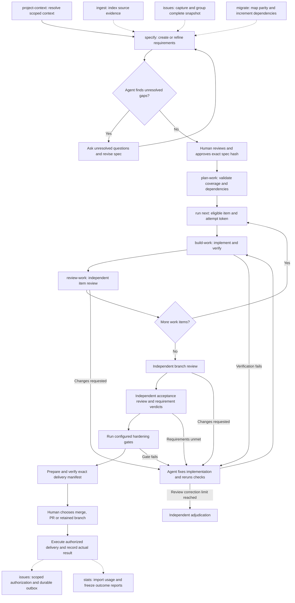

# Devflow workflow

## Work orchestration

The coordinating agent selects skills, runs helpers and arranges separate review
invocations. The journal records progress and enforces gates; it does not spawn
workers or automatically dispatch failed checks for rework. Solid arrows below
show the agent's process, including steps that require its judgment.



After changes, renew affected evidence and review packages before advancing.
Unconfigured tests are not enforced. Gap discovery/interviews are agent-led;
`spec gaps` lists recorded unanswered questions and approval does not currently
reject them automatically. Migration delivery also requires recorded predecessor
and parity evidence. Resume any stage from journaled run status and gate status.
See [specify](../specify/SKILL.md), [build-work](../build-work/SKILL.md) and
[review-work](../review-work/SKILL.md) for the focused flows.

Use the bundled helper to inspect or advance a workflow. Supply an explicit control root for stateful commands; loading this skill does not create files. Devflow supports context, repository registration, approved requirements, validated plans, resumable attempts, attempt-bound code/IaC/agent-evaluation proof, independent review records, requirement acceptance, and exact-head delivery manifests. Infrastructure apply, hardening tools, external PR creation, merge execution, and cleanup remain conditional on configured tools and explicit user authorization.

```sh
python3 <skill-directory>/scripts/run.py version
```

Store state only under the chosen root:

```sh
python3 <skill-directory>/scripts/run.py context set --root <control-root> --layer org --file org.json
python3 <skill-directory>/scripts/run.py context resolve --root <control-root>
python3 <skill-directory>/scripts/run.py repo register --root <control-root> --repo-id <stable-id> --location <checkout>
python3 <skill-directory>/scripts/run.py spec store --root <control-root> --file spec.json
python3 <skill-directory>/scripts/run.py spec validate --file spec.json
python3 <skill-directory>/scripts/run.py spec approve --root <control-root> --confirm-hash <current-content-hash> --actor-id <approving-human-id>
python3 <skill-directory>/scripts/run.py plan validate --root <control-root> --file plan.json
python3 <skill-directory>/scripts/run.py run start --root <control-root> --run-id <run-id>
python3 <skill-directory>/scripts/run.py run next --root <control-root> --run-id <run-id>
python3 <skill-directory>/scripts/run.py run gate-status --root <control-root> --run-id <run-id>
```

Resume by run ID with `run status`; the active attempt token remains bound to the saved state version. `run brief` reassembles the scoped context without issuing a token; `run inspect` retrieves the full run record on request. Submit a result with `run result`, abandon with `run abandon`, or retry a prior attempt with `run retry`. Read the exact acceptance criteria and unavailable gates returned by `run next`. A result without kind-matched verifier proof does not complete a work item. Follow the current stage from `run gate-status`: implementation, item review, branch review, acceptance, hardening, or delivery. Brief byte limits never truncate mandatory criteria; overflow reports the required size and references.

Deterministic operations record best-effort byte and duration measurements under the chosen root. Read `offload.jsonl` to inspect the measures; these bytes do not establish actual tokens saved. Reuse context projections only when source and resolver fingerprints match.

Use the focused Devflow skills for project context, specification, planning, build verification, and independent review. Prepare and verify delivery manifests, then stop at the human's local-merge / pull-request / retained-branch decision. The helper never performs those external effects automatically. Treat event journal state and evidence as authoritative. The dispatcher requires Python 3.11+ and `fcntl` on macOS/Linux; no daemon or dependencies are required.

## Documentation

Start with [project setup and initialization](../../docs/setup-and-usage.md).
See [usage guide and examples](GUIDE.md) for prerequisites, commands, input shapes,
outputs and recovery. The [documentation index](../../docs/skills.md) covers shared
setup and all DevFlow skills.
