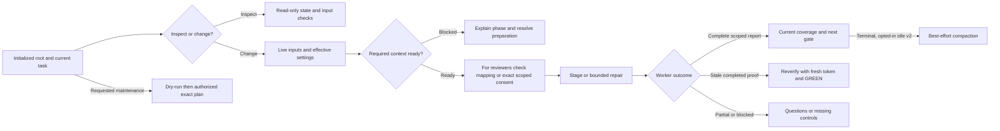

# workflow

Resolve the bundled helper; require Python 3.11+, capture `version`, and run `host init` in the actual project. Retain root/repo IDs. New roots use v2; preserve legacy format. Offer guided documents and first-use interview; resolve material decisions and ordinary prerequisites before run creation.

Inspect read-only; verify worker input bytes. Follow journal gates, eligible attempts and the active token. Require independent item/branch/acceptance reviews, hardening and exact-head delivery. After recording delivery, ask once whether to update the [DevFlow Codex site](https://devflow-field-guide.waygent.chatgpt.site/); update it only if accepted.

For [maintenance](GUIDE.md#control-state-maintenance), inspect read-only; apply an authorized exact plan and preserve history.

Read [invariants](../../docs/reference/workflow-invariants.md), stage sections and [delegation routing](../../docs/reference/task-routing.md#task-decisions). The harness runs helpers; preserve user constraints.

<!-- devflow:routes:workflow -->
- `skill.workflow`: `skills/workflow/SKILL.md`
- `common`: `docs/reference/workflow-invariants.md`
- `guide.workflow`: `skills/workflow/GUIDE.md` → workflow usage guide / Purpose and prerequisites
- `routing.task-decisions`: `docs/reference/task-routing.md` → Task routing / Task decisions
<!-- /devflow:routes -->

For stale completed code, use [reverification](../build-work/REFERENCE.md#reverify-completed-work).

For context timeout, stale preparation or mandatory overflow, follow [preparation recovery](../../docs/context-efficiency.md#preparation-recovery) before starting work.

## Documentation

Read the matching [procedures](REFERENCE.md) and [guide section](GUIDE.md) before verification, review or recovery. User entry: [quick start](../../docs/quick-start.md).

## Work orchestration

See [canonical guidance](REFERENCE.md#work-orchestration).

## Explicit project initialization

See [canonical guidance](REFERENCE.md#explicit-project-initialization).

## Shared host contract

See [canonical guidance](../../docs/reference/host-lifecycle.md).

## Governing-document evidence

See [canonical guidance](../../docs/reference/governing-inputs.md#governing-document-evidence).

## Governing input reassessment

See [canonical guidance](../../docs/reference/governing-inputs.md#governing-input-reassessment).

### Guided document setup

See [governing guidance](../../docs/reference/governing-inputs.md).

### First-use ground interview

See [governing guidance](../../docs/reference/governing-inputs.md).

[Review/repair](../../docs/reference/adversarial-review.md#bounded-live-execution).

For blocked reviewer routing, follow [scoped consent](../review-work/GUIDE.md#run-scoped-observed-reviewer-choice): exact human approval, observed high effort, unvalidated suitability and unchanged gates/budgets. Never invent mappings or revisions.
