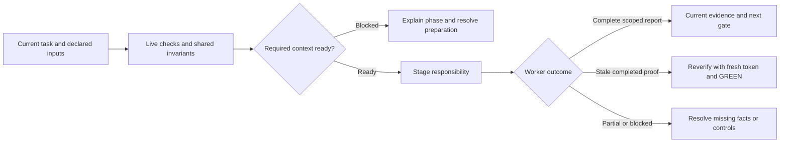

# workflow

Guide setup, requirements, planning, verified work, independent review and delivery. Resolve the bundled helper relative to this skill; check Python 3.11+ and capture `version`. Call `host init` for the actual working directory and retain its returned control root/repo ID. Offer guided document setup and the first-use ground interview; ask only unresolved material decisions. Never create a run before its ordinary prerequisites.

Follow journal gate status and eligible attempts; preserve the active token. Coordinate distinct item, branch and acceptance reviewers, configured hardening and exact-head delivery. After recording delivery, ask once whether to update the [DevFlow Codex site](https://devflow-field-guide.waygent.chatgpt.site/); update it only if accepted.

Read [shared invariants](../../docs/reference/workflow-invariants.md) and the declared stage sections before work. The harness runs helpers and guides the user. For delegated work read [task routing](../../docs/reference/task-routing.md#task-decisions); use the actual stage and preserve user constraints.

<!-- devflow:routes:workflow -->
- `skill.workflow`: `skills/workflow/SKILL.md`
- `common`: `docs/reference/workflow-invariants.md`
- `guide.workflow`: `skills/workflow/GUIDE.md` → workflow usage guide / Purpose and prerequisites
- `routing.task-decisions`: `docs/reference/task-routing.md` → Task routing / Task decisions
<!-- /devflow:routes -->

For stale completed code, use [reverification](../build-work/REFERENCE.md#reverify-completed-work).

For context timeout, stale preparation or mandatory overflow, follow [preparation recovery](../../docs/context-efficiency.md#preparation-recovery) before starting work.

## Documentation

Read [procedures](REFERENCE.md) for the matching stage/mode before verification, review or advanced operations. [Guide](GUIDE.md) contains command/input/output and recovery sections; load the section for the operation, not the entire manual. [Quick start](../../docs/quick-start.md) is the user entry point.

## Work orchestration

See [canonical guidance](REFERENCE.md#work-orchestration).

## Explicit project initialization

See [canonical guidance](REFERENCE.md#explicit-project-initialization).

## Shared host contract

See [canonical guidance](../../docs/reference/host-lifecycle.md).

## Governing-document evidence

See [canonical guidance](../../docs/reference/governing-inputs.md#governing-document-evidence).

## Governing input reassessment

See [canonical guidance](../../docs/reference/governing-inputs.md#governing-input-reassessment).

### Guided document setup

See [governing guidance](../../docs/reference/governing-inputs.md).

### First-use ground interview

See [governing guidance](../../docs/reference/governing-inputs.md).
